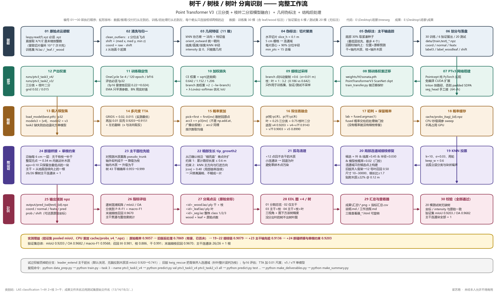

# TreePartSeg｜树干 · 树枝 · 树叶 三维点云分离识别（Terrestrial Laser Scanning）

**作者：梁艺萌**　·　**未经本人允许不得商用**（详见 [`LICENSE`](LICENSE) 与 [`NOTICE.txt`](NOTICE.txt)，每个 `.py` 顶部均有署名块）

单株 TLS（地面激光扫描）点云 `.laz` → **叶 / 枝 / 干** 三分类 → 三维分离点云 + EDL 渲染图 + 精度表。
方法：**Point Transformer V3**（三分类 + 枝叶二分双模型概率融合）＋ 几何伪标注 ＋ 结构先验后处理。

> TreePartSeg segments single-tree TLS point clouds into trunk, branch and leaf with Point Transformer V3, geometry-driven pseudo-labels and structure-aware post-processing. It keeps the trunk continuous and recovers fine twigs: mIoU 0.920, OA 0.968, macro-F1 0.957; recalls 0.981 leaf / 0.887 branch / 0.991 trunk / 0.967 twigs.

---

## 1. 精度一览

验证集 6 棵留出树（pooled 混淆矩阵）：

| 指标 | 叶 leaf | 枝 branch | 干 trunk | 总体 |
|---|---|---|---|---|
| 召回率 Recall | 0.9812 | 0.8865 | 0.9911 | — |
| 精确率 Precision | 0.9741 | 0.9097 | 0.9987 | — |
| F1 | 0.9776 | 0.8980 | 0.9949 | macro-F1 **0.9568** |
| IoU | 0.9562 | 0.8148 | 0.9899 | mIoU **0.9203** |
| 总体精度 OA | | | | **0.9682** |
| 末端细枝召回（逐树平均） | | | | **0.9670** |

- 结构指标：主干连通块 **26/26 = 1 根**（自地面连续贯通至树顶，无断裂）。
- 测试集 20 棵（无公开真值）：平均置信度 **0.9547**，木质到达率平均 **79.6%**。
- 后处理消融（pooled mIoU）：原始概率 0.9057 → 旧版后处理 0.7869（有害，已否决）→
  细枝链 0.9079 → +主干轴先验 0.9136 → +断缝桥接与单根约束 **0.9203**。
  复现：`python src/ablate_cache.py v4 ptv3_task3_v4 && python src/sweep.py ../configs/cfg4.json`。

## 2. 仓库结构

```
TreePartSeg/
├── README.md / LICENSE / NOTICE.txt / requirements.txt
├── run_pipeline.ps1       一键流水线（relocate|prep|train|val|test|tune|deliver|report|all）
├── src/                   23 个第一方 Python 源码（全部带署名块）
│   ├── data_prep.py       01–06  读 LAS / 清洗 / 11 维几何特征 / 干枝伪标注 / 落盘
│   ├── train.py           07–12  PTv3 训练（过采样 + 加权 CE + Lovász + EMA）
│   ├── train_transfer.py  08     迁移探针（冻结 backbone 只训 head）
│   ├── predict.py         13–18  TTA + 双模型融合 + 后处理 + 逐树指标
│   ├── post.py            19–24  KNN 投票 / 局部连通域细枝修复 / 孤岛 / 梢部生长 / 主干结构
│   ├── edl_render.py      28     EDL（eye-depth-cue）三视角渲染
│   ├── make_deliverables.py 25–27 出图 + 分离点云（wood / leaf / seg）
│   ├── make_summary.py    26,29  指标表 PNG + CSV + 说明.md
│   ├── make_viewer.py     29     离线三维查看器 HTML（three.js）
│   ├── make_workflow_png.py 30   工作流程图（01→30 蛇形）
│   ├── ablate_cache.py / sweep.py / ablate_eval.py   后处理消融（纯 CPU）
│   ├── check_trunk.py / refresh_stats.py             主干连通性 / 免 GPU 重算指标
│   ├── qc_one.py / make_report.py / make_results.py / export_outputs.py  早期版本与 QC
│   ├── dl_sonata.py       08     预训练权重下载（走 hf-mirror）
│   ├── relocate.py        —      把包内绝对路径改写到新根目录
│   ├── add_banner.py      —      批量写入/更新署名块（幂等）
│   └── pack_source.py     —      生成本地源码分发包
├── configs/               cfg1–cfg5.json（sweep.py 后处理变体定义）
└── docs/                  工作流程图.png、工作流程.md（446 行分步解析）、说明.md
```

> 本仓库不内嵌第三方代码与数据（许可原因），见下节获取方式。

## 3. 第三方依赖与数据准备

```powershell
# 1) Point Transformer V3（CC BY-NC 4.0 + 科研附加条款；商用请另向 Pointcept 授权）
git clone https://github.com/Pointcept/PointTransformerV3 <ROOT>\ptv3_repo
#    代码默认从 <ROOT>\ptv3_repo\src 导入 point_transformer_v3（上游即 src/ 布局）

# 2) three.min.js（MIT，仅生成离线三维查看器时需要）
#    从 https://threejs.org 下载 three.min.js 放到 <ROOT>\treeseg\three.min.js

# 3) 预训练权重（非商用许可，由脚本自动从 hf-mirror 下载，不随仓库分发）
python src\dl_sonata.py

# 4) 数据（数据提供方给出，不随仓库分发），期望布局：
#    <ROOT>\训练集\{N}.laz {N}_leaf.laz {N}_wood.laz   30 棵
#    <ROOT>\测试集\{N}.laz                             20 棵
```

## 4. 环境

```powershell
python -V            # 3.13.5（3.10+ 均可）
pip install -r requirements.txt -i https://pypi.tuna.tsinghua.edu.cn/simple
# torch 需匹配 CUDA：本项目实测 torch==2.11.0+cu128
$env:KMP_DUPLICATE_LIB_OK = "TRUE"    # Windows 下 numpy/torch 同装 libomp，必须设置
```

PTv3 使用纯 PyTorch 前向实现，**无需编译 CUDA 扩展**；`triton-windows` 可选（缺失自动回退 SDPA）。

## 5. 换机器 / 换目录（路径改写）

源码内为统一根目录绝对路径（默认 `E:\Desktop\场景`）。在新机器上先执行：

```powershell
python src\relocate.py D:\work\trees
```

`relocate.py` 会把所有脚本与文档中的 `<ROOT>` 全量改写，并在 `src/.root` 记录当前根。

## 6. 一键运行

```powershell
.\run_pipeline.ps1 -Stage prep        # 特征与伪标注
.\run_pipeline.ps1 -Stage train       # 双模型训练（GPU，约数小时）
.\run_pipeline.ps1 -Stage val         # 验证集推理 + 指标
.\run_pipeline.ps1 -Stage test        # 测试集推理
.\run_pipeline.ps1 -Stage deliver     # 成果图 / 分离点云 / 指标表 / 查看器
.\run_pipeline.ps1 -Stage all -Root D:\work\trees
```

产物：`runs/<run>/`（checkpoint、逐树 metrics json）、`成果\`（每树 4 张 EDL PNG：
分割总览 / 树干 / 树干+树枝 / 全分离，附精度数据；以及 `*|wood|leaf|seg.laz|.ply`）、
`output\`（中间 npz）、`三维查看器_*.html`（离线三维交互）。

## 7. 工作流程



01→30 全步骤文字版解析见 [`docs/工作流程.md`](docs/工作流程.md)；成果与指标口径见 [`docs/说明.md`](docs/说明.md)。

## 8. 引用与许可

- 第一方代码：Copyright © 2026 梁艺萌，保留所有权利；科研教学可自由使用，**商用需书面授权**（[`LICENSE`](LICENSE)）。
- 依赖：Point Transformer V3（Pointcept, CC BY-NC 4.0）、three.js（MIT）、Sonata / ScanNet 预训练权重（各自上游许可）。
- 数据集权属归数据提供方，本仓库不含任何点云数据。
