# 树干 / 树枝 / 树叶 分离识别 —— 完整工作流与分步解析

> **完成人：梁艺萌**　·　本成果与源代码的著作权归完成人所有，**未经本人允许不得商用**；第三方组件许可见源码包 `NOTICE.txt`。

配套图：`成果\工作流程图.png`（01→30 蛇形流程，箭头只连接相邻框）

**一句话概括**：用官方给的 `leaf/wood` 二值标注 + 一套几何算法自动造出「叶 / 枝 / 干」三分类标签，训练 Point Transformer V3（三分类模型 + 枝叶二分模型），推理时做多尺度 TTA 与双模型概率融合，再用一套**结构先验后处理**把末端细枝找回来、把主干锁成「从地面连续长到树顶的一整根」，最后输出分离点云 + EDL 三维渲染图 + 精度表。

---

## 0. 数据与总体约定

| 集合 | 数量 | 原始文件 | 标签情况 | 用途 |
|---|---|---|---|---|
| 训练集 | 30 棵 | `N.laz` + `N_leaf.laz` + `N_wood.laz` | 有叶/木二值真值；干/枝由算法伪标注 | 训练 + 调参 |
| 验证集（留出） | 6 棵（3 / 12 / 21 / 33 / 43 / 54） | 同上 | 同上 | 选模型、选后处理参数、算精度 |
| 测试集 | 20 棵（2 / 4 / 9 / 13 / 14 / 18 / 20 / 23 / 25 / 30 / 32 / 35 / 38 / 39 / 41 / 44 / 47 / 52 / 55 / 58） | 仅 `N.laz` | 无真值 | 出成果；只报结构与置信度 |

类别约定（全工程统一）：

- 训练/预测内部：`0 = 叶 leaf`，`1 = 枝 branch`，`2 = 干 trunk`
- 写入 LAS classification：`1 = 叶`，`2 = 枝`，`3 = 干`（即内部编号 +1）
- 木质部 wood = 枝 + 干；官方标注只区分 `leaf / wood`

坐标系：所有中间计算都在「去中心化坐标」（`coord = raw - shift`，`shift = (median x, median y, min z)`），输出成果时用 `shift` 还原回原始 LAS 坐标，因此分离点云与原始点云逐点一致。

---

## 1. 流程图（Mermaid，可复制到支持 mermaid 的编辑器渲染）

```mermaid
flowchart TD
  subgraph S1["① 数据准备 data_prep.py"]
    A01["01 读 LAS<br/>必须 .xyz"] --> A02["02 清洗归一<br/>clean_outliers + shift"]
    A02 --> A03["03 几何特征 11 维<br/>法向/线度/面度/球度"]
    A03 --> A04["04 伪标注·切片聚类<br/>0.1 m 片 + 5 cm 栅格 CC"]
    A04 --> A05["05 伪标注·主干轴追踪<br/>圆柱轴 + 漂移预测"]
    A05 --> A06["06 落盘 data/*.npz<br/>30 训练 / 6 验证 / 20 测试"]
  end
  subgraph S2["② 训练 train.py"]
    A06 --> B07["07 PTv3 纯 PyTorch<br/>手工 seg_head"]
    B07 --> B08["08 预训练迁移<br/>sonata.pth / ScanNet"]
    B08 --> B09["09 细枝过采样 ×0.6"]
    B09 --> B10["10 加权损失<br/>sqrt 逆类频 + Lovász"]
    B10 --> B11["11 稳定性<br/>bf16 训练 / fp32 评估 / EMA"]
    B11 --> B12["12 产出 v4 + task2_v3"]
  end
  subgraph S3["③ 推理 predict.py"]
    B12 --> C13["13 载入模型集"]
    C13 --> C14["14 多尺度 TTA<br/>0.02 + 0.015 + 翻转"]
    C14 --> C15["15 概率累加散射回原点"]
    C15 --> C16["16 双任务融合<br/>叶=0.25·3cls+0.75·2cls"]
    C16 --> C17["17 argmax 初判 + 保留概率"]
    C17 --> C18["18 概率缓存 cache/*.npz"]
  end
  subgraph S4["④ 结构后处理 post.py"]
    C18 --> D19["19 KNN 投票"]
    D19 --> D20["20 局部连通域细枝修复<br/>twig_rescue2"]
    D20 --> D21["21 孤岛清理"]
    D21 --> D22["22 梢部生长<br/>tip_growth2 路径≤0.6 m + 曲率连续"]
    D22 --> D23["23 主干圆柱先验 trunk_prior"]
    D23 --> D24["24 断缝桥接 + 单根约束<br/>trunk_finalize"]
  end
  subgraph S5["⑤ 交付"]
    D24 --> E25["25 pred_*.npz"]
    E25 --> E26["26 指标评估"]
    E26 --> E27["27 分离点云 wood / leaf"]
    E27 --> E28["28 EDL 图 ×4"]
    E28 --> E29["29 汇总表 + 三维查看器"]
    E29 --> E30["30 一致性校验"]
  end
```



---
## 2. 阶段一：数据准备（01 → 06，`treeseg/data_prep.py`）

### 01 原始点云读取
- 代码：`data_prep.py:216`（main）、`data_prep.py:188`（process）
- 输入 → 输出：`训练集/{N}.laz`、`{N}_leaf.laz`、`{N}_wood.laz`；`测试集/{N}.laz` → 三组 float32 点集
- 关键点：laspy 2.7 读坐标**必须**用 `laspy.read(f).xyz`。`X/Y/Z` 是未缩放整数（scale 之后才是米），早期版本直接取 `X` 导致切片循环空转 10⁷ 次、进程像卡死一样。
- 训练集同时读整株 `N.laz` 与标注件，验证「leaf ∪ wood = 整株」，避免标注丢点。

### 02 清洗与归一
- 代码：`data_prep.py:181`（clean_outliers）、`data_prep.py:196`（shift）
- 参数：保留 `z ∈ [p0.01 − 0.5, p99.99 + 1.0]`；`shift = (median x, median y, min z)`
- 为什么：TLS 单站扫描常有空中飞点/地面反射噪点；`min z` 作基准使「z=0 就是地面」，后面所有「主干必须从地面起」的结构约束都依赖这个归一。
- 输出：`coord`（去中心化坐标），`shift` 一路带到交付阶段用于还原原始坐标。

### 03 几何特征（11 维）
- 代码：`data_prep.py:154`（compute_normals，k=14）、`data_prep.py:164`（curvature_feats）、`data_prep.py:172`（orient_outward）
- 特征构成：`coord(3) + normal(3) + 相对高度 z(1) + 线度/面度/球度/kNN 半径(4) = 11`
  - 线度 `(λ3−λ2)/λ3`：枝条这类细长结构的判别主力
  - 面度 `(λ2−λ1)/λ3`：叶片平面
  - 球度 `λ1/λ3`：叶团/簇
  - kNN 半径：局部密度，区分致密树干与稀疏叶背
- `orient_outward` 把法向统一成「背离树轴」朝向，否则法向符号随机会让 PTv3 的 normal 输入失效。
- 为什么必须靠几何：这批数据 **intensity 全为 0**，颜色/强度类特征不可用。

### 04 伪标注（上）：水平切片 + 栅格连通域
- 代码：`data_prep.py:21`（slice_clusters）
- 参数：`slice_h = 0.1 m`，栅格 `cell = 0.05 m`，格内 `≥2` 点算占用，连通域 `min_pts = 15`，半径取 90% 分位
- 输出：每一层若干个簇 `{ids, cx, cy, r, n, zc}`
- 为什么用栅格而不是 DBSCAN：0.1 m 层内点数可达数万，栅格连通域（`scipy.ndimage.label`）是 O(N) 且天然贴合「圆柱截面」的形状；DBSCAN 在此规模下慢且对细枝会碎。

### 05 伪标注（下）：主干圆柱轴追踪
- 代码：`data_prep.py:52`（pseudo_trunk，支持 `return_axes=True`）
- 流程：
  1. 在底部 30% 高度内找「紧凑种子」：`r ≤ 0.45 m`、`n ≥ 60`、离底部质心 `≤ 0.6 m`、且上一层 0.35 m 内有延续簇
  2. 种子按「最低层优先」排序，去重后最多 `max_seeds = 4` 条候选轴
  3. 沿 z 逐层向上追踪：用「当前位置 + 漂移预测」的圆柱采样，`step > 0.14 m` 直接停止（主干近竖直，拒绝大跳变），半径上限 `0.22 m`，连续 3 层丢失则终止
  4. 判定：`干 = 落在轴 1.15r + 0.02 m 内的木质点`，`枝 = 其余木质点`
- 为什么：官方只给 leaf/wood，干/枝必须自己造。轴追踪同时给出**主干轴剖面**（z, x, y, r），后面 23/24 步直接复用它当结构先验。

### 06 划分与落盘
- 代码：`data_prep.py:188`（process）、`data_prep.py:216`（main）
- 输出：`treeseg/data/train_{id}.npz`（30）、`test_{id}.npz`（20），字段 `coord / normal / featx / label3 / label_woodleaf / shift`
- 划分：30 棵训练树中固定留出 `3, 12, 21, 33, 43, 54` 作验证（`predict.py:16` `VAL_IDS`），其余 24 棵参与训练
- 实测类别分布（24 棵训练树）：叶 4,086,519 / 枝 1,269,212 / 干 1,159,302 ≈ `0.642 : 0.186 : 0.172`，枝∶叶 ≈ 1∶3.2 —— 这是后面必须做细枝采样与加权损失的根因

---

## 3. 阶段二：训练（07 → 12，`treeseg/train.py`）

### 07 PTv3 网络搭建
- 代码：`train.py:129`（build_model）、`ptv3_repo/src/point_transformer_v3`
- 用 Pointcept 官方实现的**纯 PyTorch 前向**（免编译 CUDA 扩展）：有 triton 就走快路径，否则回退 padded SDPA
- `in_channels = 11`；`seg_head` 需手工接（backbone `forward` 输出 64 通道特征，`model.attach_head(ncls)`）
- 为什么不用官方 Pointcept 训练框架：Windows 下其 CUDA 算子编译链不可用，纯 PyTorch 版可跑通且精度一致。

### 08 预训练权重迁移
- 权重：`treeseg/weights/hf/sonata.pth`（PTv3 ScanNet 自监督 ckpt）
- 探针脚本：`train_transfer.py`（先冻结 backbone 只训 head，确认迁移有效再全量训）
- 主干约 4600 万参数（`best.pth` ≈ 176 MB，fp32）。30 棵树的小数据集**必须**靠预训练才能收敛。

### 09 细枝过采样
- 代码：`train.py:195`–`train.py:202`
- 参数：`--oversample 0.6`，即对 branch 点随机复制 60% 并加 `σ = 0.01 m` 高斯抖动
- 只作用于训练集（验证/测试不采样，保证指标可信）
- 作用：枝∶叶 = 1∶3.2 的失衡被拉平，枝召回从「几乎学不到」提升到可用。

### 10 加权损失
- 代码：`train.py:63`（lovasz_softmax）、`train.py:84`（Loss）、`train.py:164`–`train.py:172`（权重与 Loss）
- CE 权重 = `sqrt(逆类频)` 归一化 → 实测 `[0.642, 1.152, 1.206]`（叶/枝/干）
- 额外 `branch` 类权重 ×2（`--lw-branch 2.0`），同时作用于 CE 与 Lovász
- 总损失：`CE + λ·Lovász-softmax`，三分类 `λ=0.5`，二分类 `λ=1.0`
- 为什么加 Lovász：任务评价是 IoU/mIoU，Lovász 直接对 IoU 求上界梯度，比只调类别权重更能救回小目标细枝。

### 11 训练稳定性
- 优化器：AdamW（backbone `lr=5e-4`，`seg_head` `lr=5e-3`，weight_decay 0.02），OneCycle（`pct_start=0.1`），120 epoch，bf16 混合精度
- 数据增广：`train.py:29`（augment）= 随机绕 z 轴旋转 + x/y 各 50% 翻转 + 0.95~1.05 缩放 + 80% 概率加 `σ=0.004 m` 噪声
- 显存控制：单棵树超过 600,000 点则随机下采样
- **评估必须 fp32**：fp16 下 softmax 归一化失真，曾出现枝召回 0.22 → 0.024 的崩溃（这是本项目最坑的一个 bug）
- EMA（`train.py:115`）只平滑参数，BN 统计量用实时值。

### 12 产出权重
- `runs/ptv3_task3_v4/`（三分类，最终选用）、`runs/ptv3_task2_v3/`（枝叶二分，用于融合）
- 训练时长：单模型 120 epoch ≈ 54 分钟（`run_task3_v4.log` 末行 3210 s）
- 训练日志：`runs/*/log.jsonl` 每 4 epoch 记录 `val3 / val3p / val2` 三套指标

---
## 4. 阶段三：推理（13 → 18，`treeseg/predict.py`）

### 13 载入模型集
- 代码：`predict.py:25`（load_model）、`predict.py:91`（main）
- `models3 = [ptv3_task3_v4]`，`model2 = ptv3_task2_v3`；task2 缺失时自动退化为单模型（打印 "task2 model missing, no fusion"）
- 加载方式：`from_dict(cfg)` 建图 → `to_empty` + `_init_weights` → `attach_head(ncls)` → `load_state_dict(strict=False)`，精度固定 `fp32`

### 14 多尺度 TTA
- 代码：`predict.py:50`（predict_tree），体素尺度由环境变量 `GRIDS` 控制，默认 `0.02,0.015`
- 每个尺度 × 左右翻转（x 与法向 x 分量同时取反）× 每个三分类模型 = 4 次前向/树
- 实测：`0.02+0.015 = 0.9203` 最优；再加 `0.01` 反而降到 `0.9151`（过细体素破坏 PTv3 预训练时的感受野统计）
- 代价：单棵树推理 ~10 s，20 棵测试集约 25 min/卡；两卡可并行分半（GPU0 显示卡用 `BelowNormal` 优先级，避免拖慢桌面）

### 15 概率累加（散射回原点）
- 代码：`predict.py:33`（infer）
- `prepare(..., pick="first")` 做体素降采样，`inverse` 把每个体素映射回原点；用 `first[inv[::-1]] = arange` 还原「体素 → 第一个原始点」的下标
- 累加写法必须是 `acc3 += p3[inv]`（高级索引广播）；`np.add.at` 在这种形状下会报广播错误
- 翻转样本在累加前已用同一 `inv` 散射，因此多份概率始终对齐原始点序

### 16 双任务融合
- 代码：`predict.py:66`–`predict.py:68`
- `p(枝) ← p3(枝)·p2(木)`，`p(干) ← p3(干)·p2(木)`：用「是不是木质」这道二分类闸门压制叶→枝的误报
- `p(叶) ← 0.25·p3(叶) + 0.75·p2(叶)`：枝叶二分在「叶」上更可靠，权重给到 0.75
- 模型集选型（验证集 pooled mIoU）：`v4 0.9203` > `v4+v7f 0.9143` > `v7f 0.9003` > `v5 0.8990`

### 17 初判 + 保留概率
- `lab = fused.argmax(1)`，但 **`fused` 概率不丢弃**，一并传给后处理
- 这是关键设计：后处理的「细枝修复 / 梢部生长」都带**概率门控**（`p_floor`），没有概率就只能靠几何阈值，会把针叶整片误救成枝

### 18 概率缓存
- 代码：`ablate_cache.py:15`（build）→ `cache/probs_{tag}_{id}.npz`
- 之后所有后处理调参（`sweep.py`、`_ab_ladder*.py`）都在 CPU 上秒级完成，不再占用 GPU
- 代码：`sweep.py:21`（run）按 `cfg*.json` 批量跑参数组合；`refresh_stats.py` 可在**完全不重推理**的前提下重算全部指标与主干贯通字段

---

## 5. 阶段四：结构后处理（19 → 24，`treeseg/post.py`）

调用顺序（`predict.py:73`–`predict.py:74`）：

```
postprocess2(knn_vote → twig_rescue2 → remove_islands → tip_growth2 → knn_vote 轻平滑)
→ trunk_finalize(trunk_prior + 断缝桥接 + 单根约束)
```

### 19 KNN 投票
- 代码：`post.py:8`（knn_vote），默认 `k=10, sigma=0.03, iters=2, keep_w=0.6`
- 距离加权投票两轮，消除孤立误分类点与块状噪声；链尾还会再跑一次轻平滑（`k=8, sigma=0.02, keep_w=1.0`）

### 20 局部连通域细枝修复（twig_rescue2）
- 代码：`post.py:98`；实参 `predict.py:21`（TWIG_KW）
- 候选点：`叶 & 线度 > 0.45 & kNN 半径 < 0.030 & max(p(枝), p(干)) > 0.02`
- **只在候选点内部**做 `eps = 0.035` 连通域（这是修复点）
- 保留条件（全部满足才翻成「枝」）：
  - 尺寸 `10 ≤ size ≤ 30000`
  - 细长比（连通域协方差第一/第二特征值）`≥ 1.7`
  - 贴附木质：`≥ 22%` 的点在 `0.12 m` 内已有木质
  - 平均 kNN 半径 `< 0.030 × 1.5`，平均线度 `> 0.45 × 0.85`
- 为什么必须「只在候选点上建连通域」：旧版 `twig_rescue`（`post.py:37`）把已有骨架和候选点一起建图，针叶树整片叶子被连成一个大连通块并整体判为枝，leaf recall 掉到 0.517。

### 21 孤岛清理（remove_islands）
- 代码：`post.py:52`，`eps=0.06, min_size=12`
- 小于 12 点且不含干的木质小连通块 → 回退为叶，防止零碎木点污染树枝类

### 22 梢部生长（tip_growth2）
- 代码：`post.py:134`；实参 `predict.py:23`（GROW_KW）
- 从已确认的枝端点出发，沿「细而直」的脊点（`线度>0.45`、`半径<0.025`、`max(p)>0.02`）逐级外扩 `eps=0.04`
- 两道硬约束（这就是「局部连通域 + 局部曲率」思路的落地）：
  1. **累计路径长度 ≤ 0.6 m**（`max_len`）——只补漏掉的末梢，不跨越整棵树
  2. **kNN 协方差主方向与行进方向 |cos| > 0.40**（`dir_cos`）——局部曲率必须连续，弯折即停
- 效果：末端细枝召回 0.9670，且不会把叶簇糊成一片

### 23 主干圆柱先验（trunk_prior）
- 代码：`post.py:199`（`slice_h=0.1, max_seeds=3, promote=False`）
- 对「预测木质」重跑 05 的轴追踪；**轴外却被判成干的点降级为枝**
- 为什么有效：模型只看局部几何，容易把粗枝当干；轴先验是全局结构约束。树 43 的干精确率 0.955 → 0.999

### 24 断缝桥接 + 单根约束（trunk_finalize）
- 代码：`post.py:218`（`promote=True, bridge_step=0.06, wide_r=0.34, connect_eps=0.10, demote_orphans=True, r_cap=0.20, tol=1.15`）
- 三步：
  1. 轴先验（同 23）+ `promote=True`：轴内被判枝的木质升为干
  2. **沿轴每 6 cm 一层**：该层「无干有枝」→ 就地补干；整层「无点」→ 在 `0.34 m` 宽半径内就近取木质补上（每层最多 400 点，按离轴距离排序）
  3. **单根约束**：`eps=0.10` 做主干连通域，只保留含最低点的那一块，其余碎片全部降级为枝
- 结果：主干一定是「从地面连续向上的一整根」，26/26 棵树主干连通块 = 1，干底最大离地 0.34 m（验证集 21 号树），测试集 20 棵最大 0.14 m
- 可选步骤 `leader_extend`（`post.py:295`，**默认关闭**）：最大生成树沿「粗骨架」继续向上延长主干。实测 26 棵树都「无可延长」——干顶就是粗骨架最高点，再往上局部半径已低于 `τ = max(0.02, 0.35×干半径)`，属于细枝；若强行拉到木质顶点，mIoU 0.920 → 0.741。用户看到的「红色部分不是主干而是树枝」正是这一步被误开时的表现，现已默认关闭。

---
## 6. 阶段五：交付（25 → 30）

### 25 输出预测 npz
- 代码：`predict.py:118`（`np.savez_compressed`）
- 产物：`output/pred_{val|test}_{id}.npz`，字段 `coord / normal / featx / pred / prob / shift`
- `prob` 以 float16 存，方便后续只做后处理重跑而不必再推理

### 26 指标评估
- 代码：`predict.py:77`（per_class）、`predict.py:120` 之后（`tip_branch_recall`、`trunk` 统计）
- 有真值（验证集）：混淆矩阵、逐类 IoU/召回/精确率/F1、mIoU、macro-F1、OA、**末端细枝召回**
- 无真值（测试集）：类别占比、平均置信度、主干连通块数、干底/干顶/木质顶高度、贯通比例
- 末端细枝召回定义：真值木质点中「距最近叶点 0.05~0.25 m 且线度高」的最外圈细枝，被正确判为枝/干的比例
- 主干统计代码：`post.py:278`（trunk_stats），返回 `ncomp / zmin / zmax / ztop / wtop / reach / reach_wood`

### 27 分离点云（原始坐标）
- 代码：`make_deliverables.py:122`（full_labels）、`make_deliverables.py:111`（write_las）、`make_deliverables.py:98`（write_ply）
- 每树两个分离成果（按用户要求）：`<id>_wood.laz/.ply` = 树干 + 树枝（一个文件），`<id>_leaf.laz/.ply` = 树叶（另一个文件）
- 另附 `<id>_seg.laz/.ply` 整株带分类（LAS classification 1=叶 2=枝 3=干）
- 全部用 `coord + shift` 还原原始坐标，`intensity` 等其余字段从源文件 header 深拷贝，因此 `wood + leaf` 点数严格等于原始点数
- laspy 2.7 写法：子集需 `h = copy.deepcopy(src.header); h.point_count = n; out = laspy.LasData(h)`

### 28 EDL 图 ×4 / 树
- 代码：`edl_render.py:7`（render_view）、`make_deliverables.py:34`（render）、`make_deliverables.py:54`（panel）
- EDL（Eye-Depth-Cue）：按「深度差」描边，细枝轮廓不会被点云糊成一团，比单纯 RGB 散点更能看清形态
- 四张图：`01_分割总览`（叶/枝/干三色）、`02_仅主干`（红色，验证「从地面连续到顶」）、`03_主干+树枝`、`04_主干+树枝+树叶`
- **只有真分出叶的树才出 04 树叶图**（用户要求：成果里没分出的类别不要硬呈现）
- 每张图下方直接打印该树的精度/结构数据，便于逐树核对

### 29 汇总与查看器
- 代码：`make_summary.py:61`（main）→ `成果\汇总\验证集指标.png`、`成果\汇总\测试集指标.png`、`成果\汇总\指标汇总.csv`
- 文档：`成果\说明.md`（结论版）、`成果\工作流程.md`（本文件）、`成果\工作流程图.png`
- 交互三维：`make_viewer.py:10`（main，每树降采样 25000 点）→ `三维查看器_测试集.html`（10.7 MB）、`三维查看器_验证集.html`，可旋转/缩放、按类别开关（绿=叶 蓝=枝 红=干）

### 30 一致性校验
- 逐树断言：`len(wood) + len(leaf) == 原始点数`；`np.allclose(还原坐标, 原始坐标)`；`intensity` 一致；20 棵测试树一个不少
- 结果：全部通过（BAD = []），无缺树、无坐标漂移

---

## 7. 指标结果

### 7.1 验证集总体（6 棵留出树，pooled 混淆矩阵）

| 指标 | 叶 leaf | 枝 branch | 干 trunk | 总体 |
|---|---|---|---|---|
| 召回率 | 0.9812 | 0.8865 | 0.9911 | — |
| 精确率 | 0.9741 | 0.9097 | 0.9987 | — |
| F1 | 0.9776 | 0.8980 | 0.9949 | macro 0.9568 |
| IoU | 0.9562 | 0.8148 | 0.9899 | **mIoU 0.9203** |
| 总体精度 OA | | | | **0.9682** |
| 末端细枝召回（逐树平均） | | | | **0.9670** |

二分类视角（叶 vs 木质）：mIoU 0.9294 / OA 0.9689 / 叶召回 0.9812 / 木质召回 0.9409。

### 7.2 逐树明细（验证集）

| 树 | 点数 | OA | mIoU | 叶召回 | 枝召回 | 干召回 | 末端细枝召回 | 干精确率 | 主干连通块 | 干底 m | 干顶 m | 木质顶 m | 木质到达 |
|---|---|---|---|---|---|---|---|---|---|---|---|---|---|
| 3 | 193,391 | 0.9867 | 0.9553 | 0.9965 | 0.9071 | 0.9980 | 0.9862 | 0.9983 | 1 | 0.000 | 3.148 | 4.945 | 0.637 |
| 12 | 172,961 | 0.9801 | 0.8921 | 0.7776 | 0.9904 | 0.9998 | 0.9993 | 0.9998 | 1 | 0.000 | 7.700 | 8.694 | 0.886 |
| 21 | 354,262 | 0.9610 | 0.9116 | 0.9690 | 0.9371 | 0.9511 | 0.9885 | 0.9975 | 1 | 0.337 | 3.600 | 6.035 | 0.597 |
| 33 | 219,033 | 0.9886 | 0.9718 | 0.9886 | 0.9733 | 0.9998 | 0.9922 | 0.9992 | 1 | 0.000 | 7.549 | 8.154 | 0.926 |
| 43 | 493,286 | 0.9780 | 0.9319 | 0.9846 | 0.9258 | 0.9869 | 0.9874 | 0.9984 | 1 | 0.011 | 7.437 | 9.476 | 0.785 |
| 54 | 417,406 | 0.9386 | 0.8345 | 0.9846 | 0.6514 | 0.9842 | 0.8485 | 0.9921 | 1 | 0.000 | 2.099 | 4.689 | 0.448 |

- 最弱两棵：54（枝召回 0.651，极稀疏矮干 + 大叶冠，木质本身只占 3.6%）、12（叶召回 0.778，针叶与细枝在几何上几乎同构）
- 「木质到达」= 干顶 / 木质部最高点。低值不是断裂，而是**早分枝**（干在 2 m 就分成粗枝，再往上按定义属于枝）

### 7.3 测试集结构统计（20 棵，无真值）

- 主干连通块：**20/20 全部 = 1 根**，不存在断裂主干
- 干底离地：最大 0.142 m（18 号），其余 ≤ 0.032 m，即从地面起算
- 木质到达率：平均 79.6%，最高 100%（44 号），最低 43.0%（39 号，早分枝矮干型）
- 平均置信度：0.9547
- 完整逐树数值见 `成果\汇总\指标汇总.csv` 与 `成果\测试集\<id>\metrics.json`

---
## 8. 后处理消融阶梯（验证集 6 棵 pooled；用 `cache/probs_v4_*.npz` 在 CPU 上重放，不含 GPU 推理）

| 阶段 | 内容 | mIoU | OA | 叶召回 | 枝召回 | IoU 叶/枝/干 |
|---|---|---|---|---|---|---|
| A 原始概率 argmax | 13~18 走完，未后处理 | 0.9057 | 0.9651 | 0.9900 | 0.8352 | 0.9562 / 0.7909 / 0.9701 |
| B 旧版后处理（已否决） | `post.py:87` postprocess | 0.7869 | 0.8874 | 0.8699 | 0.8747 | 0.8473 / 0.5458 / 0.9678 |
| C 新版 19~22 | knn_vote + twig_rescue2 + remove_islands + tip_growth2 | 0.9079 | 0.9651 | 0.9812 | 0.8747 | 0.9562 / 0.7971 / 0.9703 |
| D +23 主干轴先验 | trunk_prior | 0.9136 | 0.9664 | 0.9812 | 0.8866 | 0.9562 / 0.8056 / 0.9788 |
| E +24 桥接与单根约束 | trunk_finalize（最终） | **0.9203** | **0.9682** | 0.9812 | 0.8865 | 0.9562 / 0.8148 / **0.9899** |

怎么读这张表：

- 模型本身已经很强（A = 0.9057），后处理净贡献 **+0.0146 mIoU**；其中主干结构（23+24）占 **+0.0124**，细枝链（19~22）占 +0.0022 —— 但后者的真正价值体现在**末端细枝召回 0.9670** 和枝 IoU 0.7909 → 0.8148，单看 mIoU 会低估它。
- B 行是「无门控的几何救回」的反面教材：pooled 叶召回 0.9900 → 0.8699，枝 IoU 0.7909 → 0.5458。逐树看更清楚：12 号树 leaf recall **0.497**（早期版本实测 0.517）、21 号 0.675、54 号 0.892；换成新版 C~E 后 12 号回到 0.778、21 号 0.969、54 号 0.985。
- 干 IoU 0.9701 → 0.9899 完全来自结构先验（D、E 两步），与模型无关：模型看局部几何，结构先验看全局形态。

## 9. 模型 / 参数选型记录（全部在验证集上实测）

| 对比项 | 候选 | 验证集 mIoU | 结论 |
|---|---|---|---|
| 三分类模型 | v4 / v5 / v7f（细体素）/ v4+v7f | 0.9203 / 0.8990 / 0.9003 / 0.9143 | 选 **v4** |
| 末端细枝召回 | v4 / v5 / v7f | 0.9670 / 0.9611 / 0.9228 | v4 同时最优 |
| TTA 体素尺度 | 0.02+0.015 / +0.01 / 0.0125+0.01 | 0.9203 / 0.9151 / 0.9109 | 取两尺度 |
| 融合权重（叶） | 0.25·3cls + 0.75·2cls | 0.9203 | 优于纯三分类 |
| 主干延长 | leader_extend 开 / 关 | 0.741 / **0.920** | **默认关闭** |
| 细枝修复门控 | 概率门控 p_floor=0.02 / 无门控 | 0.9203 / 叶召回 0.517 的版本 | 必须门控 |

---

## 10. 踩过的坑 → 定位 → 修复（按影响大小）

| # | 现象 | 定位过程 | 根因与修复 | 收益 |
|---|---|---|---|---|
| 1 | 针叶树叶片被整片「救」成枝条（12 号树 leaf recall 0.497，早期实测 0.517） | 逐树看 04 图发现叶冠成块变蓝；打印连通域尺寸发现单块 10⁵ 点 | 旧 `twig_rescue` 把已有木质骨架和候选点一起建连通图，叶簇被骨架串成一块 → 改为**只在候选点上建连通域**，并加尺寸/细长比/贴附/半径四道门 + 概率门控 | 12 号叶召回 0.497 → 0.778，pooled 叶召回 0.8699 → 0.9812 |
| 2 | 主干断裂、且红色「主干」其实是粗枝 | `check_trunk.py` 打印 ncomp：树 43 主干碎片 14 块 | 模型只看局部几何 → 引入 `trunk_prior` 轴先验 + `trunk_finalize` 6 cm 分层桥接 + 只保留与地面连通的一块 | ncomp 14 → 1；干精确率 0.955 → 0.999；树 21 干召回 0.565 → 0.998 |
| 3 | 枝召回从 0.22 崩到 0.024 | 同权重同数据，只改了评估精度 | fp16 评估下 softmax 归一化失真 → 评估/推理强制 fp32 | 恢复可用；训练仍 bf16 省显存 |
| 4 | 数据处理「像卡死」，单棵树跑十几分钟不动 | 打印切片循环计数，发现 z 范围是 10⁷ 量级 | laspy 2.7 直接取 `X/Y/Z` 得到的是**未缩放整数** → 一律用 `.xyz` | 单树预处理从分钟级降到秒级 |
| 5 | 末端细枝仍然漏（枝 IoU 0.79 上不去） | 按「距最近叶的距离」分环统计召回，发现 0.05~0.25 m 环最差 | 加 09 细枝过采样 + 10 加权损失/Lovász + 22 带路径与曲率约束的梢部生长 | 末端细枝召回 0.9670 |
| 6 | 把主干「延长」到树顶反而更差 | 消融 `leader_extend` | 延长路径会把粗枝当干（mIoU 0.920 → 0.741）。主干顶端 = 足够粗的骨架能到达的最高点，再往上按定义就是枝 | 关闭该步，并在成果里明确「红色单根 = 主干，其余木质 = 枝」 |
| 7 | 训练时并发跑 `data_prep` 导致 npz 读到一半崩溃 | 复现时序 | 训练在读 `data/*.npz` 时重写文件 → 规定数据准备与训练不并发 | 稳定复现 |

---

## 11. 复现命令（Windows PowerShell）

```powershell
cd E:\Desktop\场景\treeseg
$env:KMP_DUPLICATE_LIB_OK = "TRUE"

# 01-06 数据（不要在训练并发执行）
python data_prep.py

# 07-12 训练（三分类 + 枝叶二分；GPU0 是显示卡，建议后台低优先级）
Start-Process python -ArgumentList "train.py","--task","3","--name","ptv3_task3_v4" -WindowStyle Hidden
Start-Process python -ArgumentList "train.py","--task","2","--name","ptv3_task2_v3" -WindowStyle Hidden

# 13-18 + 19-24 推理（验证集 -> 测试集）
$env:GRIDS = "0.02,0.015"
python predict.py val  ptv3_task3_v4 ptv3_task2_v3 all
python predict.py test ptv3_task3_v4 ptv3_task2_v3 all

# 后处理调参：先把融合概率缓存下来（一次性，需 GPU），之后全部在 CPU 上秒级重放
python ablate_cache.py v4 ptv3_task3_v4          # -> cache/probs_v4_{id}.npz
python sweep.py cfg4.json 3,12,21,33,43,54 v4    # 变体名 -> {twig, grow, iters, trunk_prior, trunk_finalize}

# 25-30 交付
python make_deliverables.py val                  # 验证集 6 棵（图 + 分离点云）
python make_deliverables.py test                 # 测试集 20 棵
python make_summary.py                           # 汇总表 PNG + 指标汇总.csv
python make_viewer.py "pred_test_*.npz" 25000 三维查看器_测试集.html
python make_workflow_png.py                      # 工作流程图.png
```

双 GPU 并行（测试集 20 棵拆两半，各写一个 tag，最后合并）：

```powershell
$env:CUDA_VISIBLE_DEVICES = "0"; $env:GRIDS = "0.02,0.015"
python predict.py test ptv3_task3_v4 ptv3_task2_v3 13,14,18,2,20,23,25,30,32,35 g0
$env:CUDA_VISIBLE_DEVICES = "1"
python predict.py test ptv3_task3_v4 ptv3_task2_v3 38,39,4,41,44,47,52,55,58,9 g1
python refresh_stats.py test g0; python refresh_stats.py test g1
```

- `predict.py:5` 用 `setdefault("CUDA_VISIBLE_DEVICES", "0")`，外部设置的环境变量优先，所以可以一卡一进程
- 命令行参数：`predict.py <val|test> <runs3,csv> <run2> <ids|all> [tag]`，tag 决定 `output/metrics_{which}_{tag}.json`
- GPU0 是显示卡：起进程后执行 `Get-Process python | ForEach-Object { $_.PriorityClass = "BelowNormal" }`，避免拖慢桌面
- `refresh_stats.py` 只用 CPU 重算指标与主干贯通字段，不需要重新推理

---

## 12. 成果目录结构

```
成果\
├── 工作流程图.png              # 01→30 蛇形流程图
├── 工作流程.md                 # 本文件
├── 说明.md                     # 结论版说明
├── 三维查看器_测试集.html       # 20 棵，可旋转 / 按类开关
├── 三维查看器_验证集.html       # 6 棵
├── 测试集\<原始文件名>\          # 20 个文件夹，名字沿用测试集原始名
│   ├── 01_分割总览.png
│   ├── 02_仅主干.png
│   ├── 03_主干+树枝.png
│   ├── 04_主干+树枝+树叶.png
│   ├── <id>_wood.laz / .ply    # 树干 + 树枝
│   ├── <id>_leaf.laz / .ply    # 树叶
│   ├── <id>_seg.laz / .ply     # 整株 class 1/2/3
│   └── metrics.json
├── 验证集\<id>\                 # 6 个，结构同上（多一套真值指标）
└── 汇总\
    ├── 验证集指标.png
    ├── 测试集指标.png
    └── 指标汇总.csv
```

---

## 13. 已知局限与可继续优化的方向

- **早分枝 / 矮干型树**（39、54、25 号）木质到达率 43%~53%：算法把「主干」定义为足够粗的连续圆柱，这类树在 2 m 左右就分叉。若业务要「到顶」，需要接受把粗枝算进主干（当前消融显示这会牺牲 ~0.18 mIoU）。
- **针叶树**（12 号叶召回 0.778）：针叶与细枝在几何特征上几乎同构，纯几何（intensity 全 0）已到瓶颈。可引入回波宽度 / 多回波、或超点（superpoint）级别的 CRF 平滑。
- **叶召回与细枝召回的权衡**：把 `TWIG_KW.p_floor` 从 0.02 提到 0.10 可让叶更纯净，但末端细枝召回从 0.967 掉到 0.949；当前取「宁可多救一点细枝」的档位。
- **速度**：测试集 20 棵全量推理约 25 min/卡（4 次前向/树）。若只要可视化，可把 TTA 降为单尺度（mIoU −0.01 量级）换取 2 倍速度。
- **主干起点**：验证集 21 号干底离地 0.337 m（地面点缺失导致），若需要严格 0 m 起，可在 24 步把 `bridge_step` 层往下多补一层（当前只在轴覆盖范围内补）。
